# Diego Bassan

**`Desenvolvedor .Net`**

Me chamo Diego Bassan, tenho 36 anos e sou de Petrópolis no Rio de Janeiro. Sou pós graduado em Engenharia de Sistemas.

Desenvolvedor .NET com mais de 15 anos de experiência em desenvolvimento de software, atuando principalmente com aplicações backend, APIs, sistemas ERP e arquitetura de software.

Tenho experiência com tecnologias do ecossistema Microsoft, incluindo ASP.NET Core, Worker Services, Windows Forms, SQL Server, PostgreSQL, Entity Framework, Dapper e Azure.

Ao longo da minha carreira trabalhei no desenvolvimento e evolução de sistemas de grande porte, participando desde a análise de requisitos até a implementação de soluções escaláveis e de alto desempenho.

Além do ambiente corporativo, gosto de explorar tecnologia como hobby. Tenho interesse em Linux, self-hosting, automação residencial, Raspberry Pi e Ruby on Rails, que utilizo em projetos pessoais e estudos contínuos.

Venho construindo e evoluindo uma solução de inspeção de fachadas de edifícios que utiliza .NET, React, PostgreSQL com PostGIS e inteligência artificial para detectar anomalias a partir de fotos capturadas por drones.

Sou apaixonado por desenvolvimento de software, boas práticas, arquitetura limpa e aprendizado constante.

    
    
    

    
    

---

### 🤖 Linguagens e Tecnologias

#### Linguagens e Frameworks

  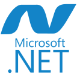
  
  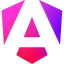
  
  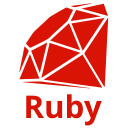
  

#### Bancos de Dados

  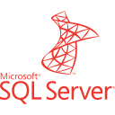
  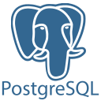
  
  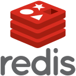

#### Cloud & DevOps

  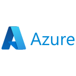
  
  
  
  

#### Ferramentas

  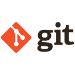
  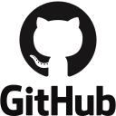
  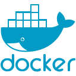
  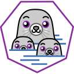

